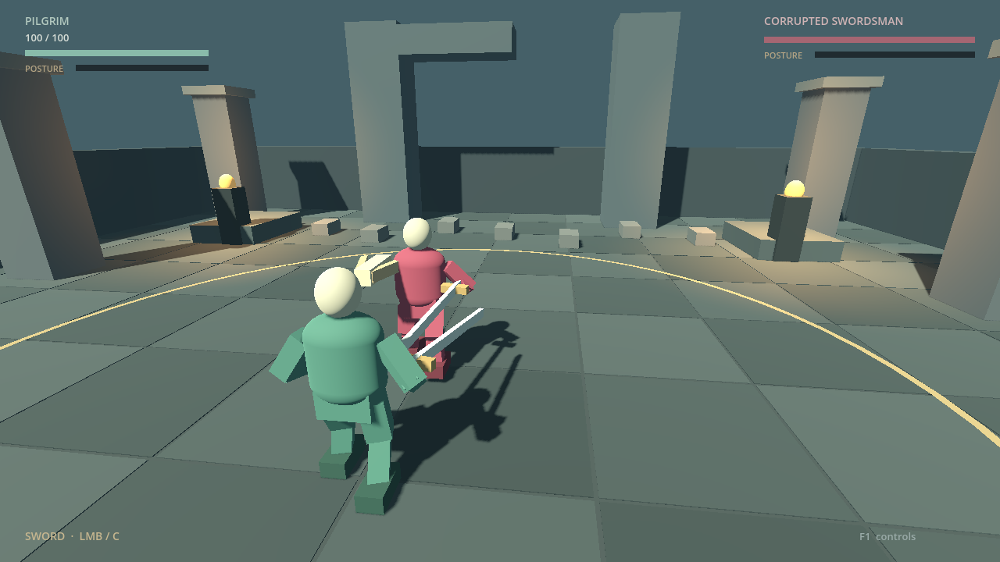
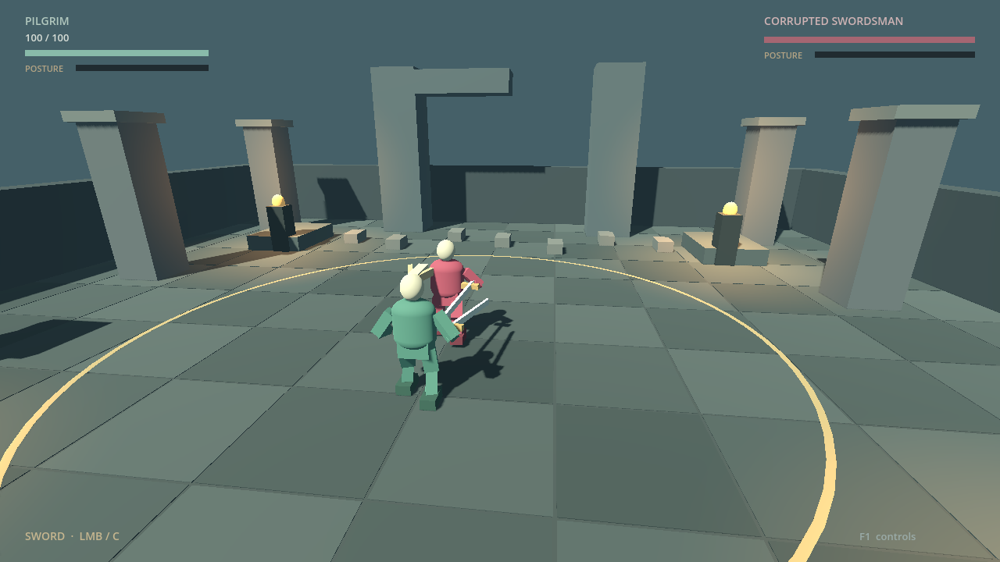
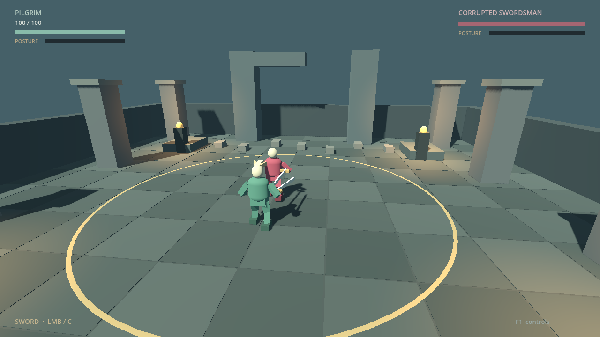
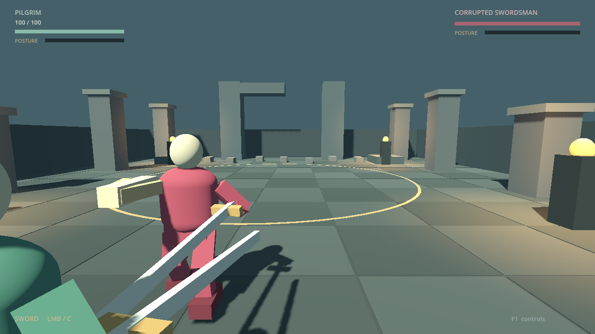
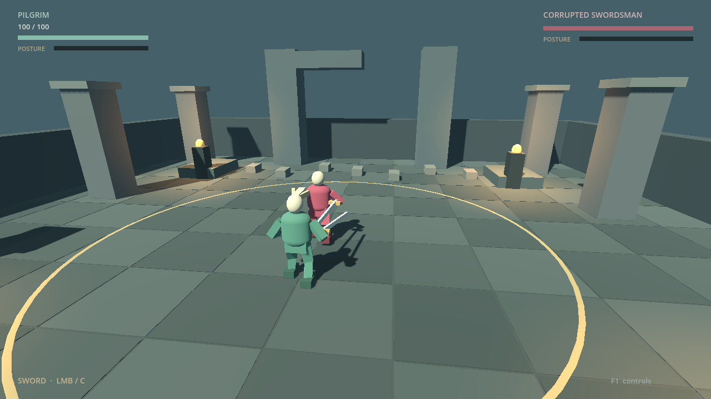

# Camera zoom — rendered evidence and validation

Baseline: fetched `main`, **2fad81b**, containing combat presentation PR #19.
Engine: **4.7.2.stable.official.ed1daf0bf**, with the installed executable checked
against the SHA-512-verified pinned official archive. Native captures use Godot
GL Compatibility under Xvfb/llvmpipe at 1280×720, fixed 60 Hz simulation.

## Views

| Close, 3.25 m | Default, 6.0 m | Far, 7.5 m |
| --- | --- | --- |
|  |  |  |

These are full, unaltered engine frames from the player camera in the real salvage
courtyard. The controlled fixtures pause enemy AI/duel resolution to measure the
camera independently. Player input, locomotion, combat state and camera physics
remain live. They demonstrate visible geometry, not human recognition or feel.
The far frame is taken after a close strafe/orbit and reset; all three use the same
fighter placement and lock-on framing.

[Close attack while zooming](rendered/09_close_attack.png) ·
[Held guard while zooming](rendered/06_locked_guard_zoom.png) ·
[Enemy behind, reframed](rendered/07_enemy_behind_reframed.png) ·
[F1 help with the wheel entry](rendered/08_controls.png)

## Near-wall recovery

| Obstructed | Recovered in open space |
| --- | --- |
|  |  |

The wall fixture places the player at z=10.5, looking forward with the camera
behind. Preferred length stays **7.5 m**, while the wall shortens actual length to
approximately **0.864 m**. Two up-scroll steps select **6.2 m** while obstructed.
The fixture then repositions the fighters in open space and measures recovery to
**6.2 m**, retaining the new selection. The wall does not write a hit length into
the preference. Immediate obstruction can crop the player, as in the existing
camera; the minimum bound applies to preferred distance, not collision clearance.
The separate pillar and shoulder-anchor checks also pass. See exact frame values
and assertions in [the rendered checks](logs/zoom-rendered-checks.json).

## Executed checks

All final runners passed with no unexpected engine errors. Expected negative
controls failed as required.

| Validation | Result |
| --- | --- |
| Focused zoom | 89 headless, 98 rendered checks; 3 source mutation controls |
| Combat / adapter / graphical | 118 / 532 / 111 checks, plus existing negative/timing controls |
| Presentation | 319 headless, 326 rendered checks, plus pose/reaction controls |
| Marrow progression | 193 rule checks; input playthrough completes at tick 857 |
| Default-camera Marrow trace | 856 samples identical before/after and headless/rendered |
| Browser | 27 checks; unchanged baseline: 18 checks |
| Build / anatomy / worldgen | 137 / 190 / 80 checks; 2 / 2 / 16 examples regenerate identically |

Final results and commands are recorded with [the tuning and reproduction guide](../../CAMERA_ZOOM.md).
The machine-readable [results](results.json) and [runner logs](logs/) retain counts,
expected negative exits and trace comparisons. Baseline runs use the untouched
original checkout; final runs use the isolated feature worktree.

The focused suite covers real wheel direction/factor, releases/disabled input,
clamps, smooth convergence and rapid reversal; all pitch extremes; close strafe,
attack/guard/dodge and backward movement while locked; manual override; enemy
behind/both approaching; wall/pillar obstruction and recovery; defeat/retry,
salvage/equip/next duel and inherited attack; and F1/F3. Source mutations that snap
the arm, reset preference or disable collision must each fail a named assertion.

The existing native, presentation and Marrow runners retain their negative controls,
AI playthroughs and pose/rule isolation. Browser tests boot both release and QA
exports in local Chromium and exercise actual browser wheel input; the release has
no QA bridge. Build/anatomy/worldgen runners also verify byte-identical examples.
Neither local web export is published.

An initial new browser assertion assumed 100 DOM pixels equaled one wheel unit.
The [isolated input probe](logs/browser-wheel-units.json) measured three units in
the pinned engine. The final browser test uses 1/0.03 pixels per unit, matching
the native factor=1 sensitivity check; camera runtime code needed no correction.

Human desktop feel, high-refresh response and readability remain **pending**.
Follow [the human playtest steps](../../CAMERA_ZOOM.md#human-playtest), especially
walking away from walls/corners, recognizing attacks at both limits, and changing
zoom during real AI pressure. The software renderer is not desktop GPU performance
evidence. No combat rule/stat/AI, camera design, physics interpolation or dependency
change is included.
