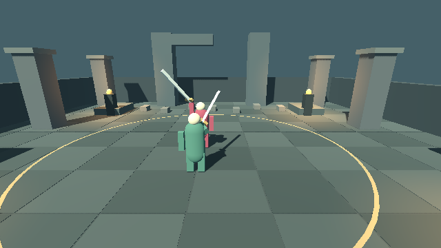
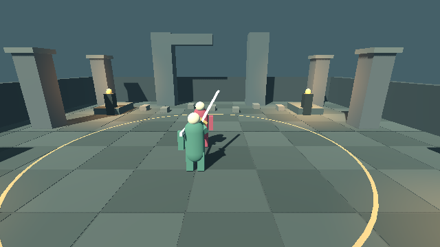
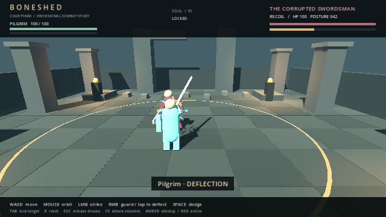

# Shared-build combat integration evidence

Baseline: untouched `main` at `4c651e3ce6a7b74201728fe2acf7c2c501f95548`.
Implementation: this PR. Captured 2026-10-17/18 UTC using the checksum-verified
`4.7.2.stable.official.ed1daf0bf` engine, Linux x86_64, Xvfb, GL Compatibility,
Mesa 25.0.7 llvmpipe (LLVM 19.1.7, 256 bits), and Chromium/SwiftShader for WebGL.
The [setup log](engine-setup.log) records official SHA-512 verification.
No browser preview was published.

## Runs

| Suite | Before | After |
| --- | --- | --- |
| Shared combat | 118 passed | 118 passed |
| Rendered/input | 111 passed | 111 passed |
| Encounter regression gates | 8 passed | 8 passed |
| Headless weapon timing | 159 passed | 159 passed |
| Rendered weapon timing | 209 passed | 209 passed |
| Shared build / salvage | 137 passed | 137 passed |
| Worldgen / regenerated examples | 80 passed | 80 passed |
| Desktop browser | 18 passed | 18 passed |
| Live build integration | — | 76 passed |

Before and after native runs execute the same 118 combat and 111 rendered/input
assertions without changing those tests. The integrated runner additionally checks
the shared-build bridge and an invalid-startup subprocess. Browser tests retain all
18 existing desktop checks and audit both production and QA release exports. The
production export explicitly includes `data/builds/*.json` and excludes QA code.

The native test window is **640×360**, with the same 16:9 framing in both runs;
the browser test remains **960×540**. The original 1280×720 native run was stopped
while progressing toward the graphical timeout on this two-CPU cloud executor.
It had passed the headless checks and recorded all five 720p checkpoints. A short
restart with an incorrectly positioned resolution argument was also stopped;
all reported native results come from the subsequent complete 640×360 runs.
No assertion or scenario was skipped in those successful runs.

The native runs use this wrapper (engine CLI options precede the `--` separating
QA arguments):

```sh
#!/usr/bin/env bash
exec /workspace/tools/godot-4.7.2/Godot_v4.7.2-stable_linux.x86_64 --resolution 640x360 "$@"
```

With that executable saved as `/tmp/boneshed-test-godot`:

```sh
GODOT_BIN=/tmp/boneshed-test-godot BONESHED_GRAPHICAL_TIMEOUT=900 \
  bash scripts/tooling/test.sh artifacts/gate2-native
bash scripts/tooling/test_builds.sh artifacts/gate2-builds
bash scripts/tooling/test_worldgen.sh artifacts/gate2-worldgen
bash scripts/tooling/test_web.sh artifacts/gate2-web
```

Full local artifacts are in `/workspace/Boneshed/artifacts/gate2-before/` and
`/workspace/Boneshed-gate2/artifacts/gate2-after/`. The committed subset below
contains logs, authoritative samples and before/after PNGs;
release ZIPs and duplicate sequence frames are intentionally kept out of the PR.

## Comparative behavior

All eight `live_strategy` records are exactly equal, including simulation frames,
health and event counts. The eight encounter regression records also compare exactly.
The skilled native deflect/punish bot wins in **418 ticks**, untouched. The following
are preserved observations, not new balance goals:

| Strategy | Before and after |
| --- | --- |
| Attack only | Loses at 10.43 s; enemy 37.36 HP |
| Guard 9 ticks on / 1 off, punish breaks | Loses at 26.23 s; zero deflections |
| Hold guard | Loses at 26.23 s |
| Backstep windup, then punish | Wins untouched at 14.35 s (existing spacing weakness retained) |

`comparison.json` records hashes for every generated native PNG and comparison
results for graphical state/footwork records, basic/heavy weapon samples and strategies.
The baseline runtime fixture in `scripts/qa/fixtures/combat_runtime_baseline.json`
was generated by `combat_build_snapshot.gd` against the untouched checkout; the
live integration test compares its trace byte for byte. It covers both actors'
configuration, phase transitions and hit/block/deflect/rear/dodge/break outcomes.

**Observed native differences: none.** All **55 generated PNGs are byte-identical**,
including the five duel checkpoints, ten phase images and forty release/contact
sequence frames. Both complete graphical state/check records (including 418 bot
ticks and NPC phase travel), both weapon-transform traces and all encounter/strategy
records are exactly equal. The committed image subset retains the checkpoints and
phase images; the manifest also hashes all generated sequence frames.

| Capture | Before | After |
| --- | --- | --- |
| Heavy release |  |  |
| Heavy contact |  |  |
| Deflection |  |  |

All four browser PNGs also match byte for byte. The browser harness uses wall-clock
input waits, so these images are not a synchronized timing benchmark. Its elapsed
QA tick counter differs at the keyboard-movement checkpoint (172 before, 165 after),
while the captured player state, attack travel/turn measurements and screenshots
match. No gameplay or rendering difference was observed in the compared fixtures.

## Independent negative controls

Both full native suites run the existing eight controls: guard mitigation,
deflection timing, windup activation, rearm protection, rear protection, committed
heavy resistance, AI defense and weapon presentation. Every control must exit 1
and fail its named assertion.

The integrated runner also expects one clear startup error and exit 1 for an
invalid second actor, and asserts that neither fighters nor world nodes were
created. Expected errors in this subprocess are checked separately; normal runs
reject all engine/script errors.

Two additional source mutations were run separately from those controls, then
restored before the final positive suites:

- In `BuildAdapter.create_state`, skip applying fields ending in `_damage`.
  The unchanged duel still matches its defaults, but the controlled data-change
  regression must fail `data_change_reaches_live_hit_damage_and_posture`.
- In `BuildRules._resolve_abilities`, omit merging profile ability overrides.
  `enemy_per_attack_timing_preserved` must fail, along with baseline parity.

[`mutations/results.json`](mutations/results.json) records the expected exits and
assertions; the associated logs retain all failed checks. The positive 76-check
integration suite also exercises malformed prerequisites, numeric overflow,
unsupported modules/shapes, frozen-catalog reload failure and controlled live data
changes. No source mutation is present in the final implementation.

## Evidence index and limits

- `before/native/`, `after/native/`: full runner logs, exits, state/check records,
  five duel checkpoints and the adapter/startup checks after integration.
- `before/timing/`, `after/timing/`: early/committed/release/active/recovery images
  for basic and heavy attacks, plus each tick's authoritative transform/contact data.
- `before/web/`, `after/web/`: release/QA export audit logs, 18-check results,
  browser consoles/errors and four captures from real desktop input.
- `before/strategies.json`, `after/strategies.json`, and `encounters.json`:
  deterministic strategy and encounter measurements.
- `before/builds.log`, `after/builds.log`, `worldgen.log`: standalone suites.

These tests demonstrate deterministic rule/input/rendering parity for the fixtures.
They do not establish human feel, GPU/refresh-rate equivalence or subjective attack
readability. The primitive silent duel, existing camera occlusion and spacing
weaknesses are preserved. Unsupported signature modules still fail compatibility;
there is no gameplay salvage/equip flow in this PR.
