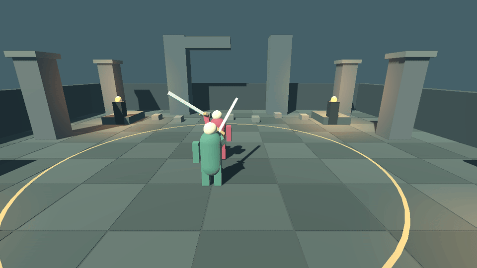
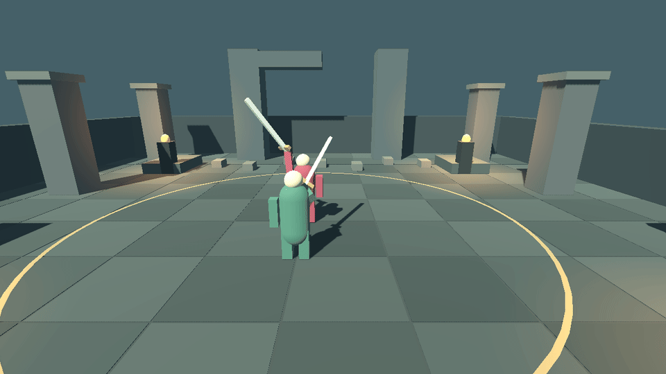

# Combat iteration 2 evidence

Engine checked by every runner: **4.7.2.stable.official.ed1daf0bf**. Baseline source:
`d4622d60bdc71ebe29e96c1b31e22a85b963a424`. Rendered native tests use GL Compatibility,
Xvfb and Mesa llvmpipe (LLVM 19.1.7); browser tests use headless Chromium/SwiftShader.
No human gameplay assessment was performed.

| Evidence | Baseline | Iteration 2 |
| --- | --- | --- |
| Shared combat checks | [33 pass](baseline/native/combat.log) | [118 pass](after/native/combat.log) |
| Native graphical/input | [37 pass](baseline/native/graphical.json) | [111 pass](after/native/graphical.json) |
| Desktop browser | [14 pass](baseline/browser/checks.json) | [18 pass](after/browser/checks.json) |
| Full adversarial measurements | [75 records](baseline/probe/probe.json) | [75 records](after/probe/probe.json) |
| Added encounter gates | — | [8 pass](after/native/encounters.log) |
| Rules/weapon transform timing | — | [159 headless checks](after/native/timing_headless.log), [209 rendered checks](after/native/timing_rendered.log) |
| Expected negative controls | [3 exit 1](baseline/native/runs.json) | [8 exit 1](after/native/runs.json) |

[Before/after measurements](measurements.json) pair the unchanged adversarial
policies. [Implementation, tuning and human checklist](../../COMBAT_ITERATION_2.md)
explain the results and remaining spacing/camera limitations.

## Rendered timing

Both sequences use the real courtyard, default camera geometry at 2 m, procedural
fighter meshes, and authoritative 60 Hz rule samples. The player holds guard so a
resolved hit does not truncate the observed swing. HUD and debug volumes are hidden.
Every second physics sample is captured (30 fps). GIFs below play at **one third
speed** for inspection; MP4 links play at the recorded 30 fps. PNGs show the first
sample in each stage (early pose is sampled after eight preparation ticks).

| | Basic | Heavy |
| --- | --- | --- |
| Release/contact/recovery, slowed |  |  |
| Recorded speed | [Basic MP4](after/timing/basic.mp4) | [Heavy MP4](after/timing/heavy.mp4) |
| Early | [PNG](after/timing/basic/early.png) | [PNG](after/timing/heavy/early.png) |
| Committed | [PNG](after/timing/basic/committed.png) | [PNG](after/timing/heavy/committed.png) |
| Release, still no hit | [PNG](after/timing/basic/release.png) | [PNG](after/timing/heavy/release.png) |
| First active/contact | [PNG](after/timing/basic/active.png) | [PNG](after/timing/heavy/active.png) |
| Recovery | [PNG](after/timing/basic/recovery.png) | [PNG](after/timing/heavy/recovery.png) |
| Every tick: stage, blade transform, contact | [JSON](after/timing/basic/samples.json) | [JSON](after/timing/heavy/samples.json) |

The fixture asserts no contact before ACTIVE or during recovery, a blade tip already
at forward reach on first contact, forward weapon presentation on every active tick,
one resolved hit, release movement before contact, and unchanged active duration.
It also verifies front/rear guard through actual Fighter hit resolution. This is
phase/reach alignment; the prototype still uses a box hit shape, not blade-mesh sweeps.

## Negative controls and provenance

Defensive-cancel regressions [fail 17 checks on the previous code](defense-cancels/before.log)
and [pass all 25 after the change](defense-cancels/after-headless.log). The final
111-check rendered suite includes these same checks, with actual incoming hits
while dodge travel is disabled, immediate guard/deflection, canceled hit/volume
removal, no delayed damage and same-tick input priority. The 118-check combat suite
also covers 0 / 0.15 / 0.299 / 0.301 s invulnerability boundaries, heavy/basic cancels,
all three attack phases, cooldown failure and retained guard rearm protection.
Browser Space/RMB tests use the QA-only 4 s windup fixture to isolate transport
latency; native cases use normal durations. Production attack timing is unchanged.

The NPC's live attack now includes circling and distance maintenance. See the
[slowed rendered footwork sequence](movement/npc-footwork.gif),
[recorded-speed video](movement/npc-footwork.mp4) and
[real scene states](movement/npc-rendered.json). This footage runs the enabled AI;
the fixed-pose timing fixture above is deliberately separate.

The added steering/NPC checks [fail 11 assertions before this fix](movement/steering-before.log).
The complete focused suite [passes 49 checks afterward](movement/steering-after.log),
covering key/mouse turning and live NPC travel through every attack phase. These
are included in the final 111-check rendered suite.

The follow-up attack-movement checks also ran against the previous rooted Fighter:
[26 failures, as expected](movement/rooted-before.log). The same real-input suite
[passes all 38 checks after the fix](movement/after-headless.log); those 38 checks
are included in the final 111-check rendered suite as well. They cover locomotion
in all three attack phases, four movement directions with lock on/off, redirection,
moving hit volumes, collision and retained hit-reaction restrictions.

The native runner fails if the designated assertion does not fail or the process
does not exit 1 for a negative control:

| Log in `after/native/` | Intentional defect |
| --- | --- |
| `negative_guard.log` | Disable guard health mitigation |
| `negative_deflect.log` | Remove the perfect window |
| `negative_phase.log` | Allow a windup hit |
| `negative_toggle.log` | Remove rearm delay |
| `negative_rear.log` | Protect the rear hemisphere |
| `negative_poise.log` | Remove committed-windup resistance |
| `negative_defense.log` | Disable swordsman's guard/counter policy |
| `negative_visual.log` | Turn the active sword backward while hit rules remain active |

`runs.json` records actual and expected exits. The baseline browser and probe were
run against unchanged main. Baseline native evidence is the complete run against
an isolated archive of that same commit, with a 600 s graphical timeout. Earlier
sandbox socket failures and a 180 s baseline timeout are described in the iteration
guide; they are not substituted for successful final evidence. An intermediate
development run was discarded after its runner file changed while it was running;
the final native evidence comes from a clean run of the completed runner.

Release/QA manifests audit packed resources and record file hashes. No hosted
preview was published by this task. Browser screenshots demonstrate desktop input;
the release has no QA bridge or touch adapter. All evidence here is automated,
and success does **not** establish that the duel is fun or that every input cadence
or hardware configuration has been tested.

## Reproduce

From repository root, use fresh output paths:

```sh
BONESHED_GRAPHICAL_TIMEOUT=600 bash scripts/tooling/test.sh artifacts/iteration2-native
bash scripts/tooling/probe.sh artifacts/iteration2-probe
bash scripts/tooling/test_web.sh artifacts/iteration2-web

# Optional: create recorded-speed video from the native runner's frame sequence.
ffmpeg -framerate 30 -i artifacts/iteration2-native/timing-rendered/basic/frame_%03d.png \
  -c:v libx264 -pix_fmt yuv420p basic.mp4

# Optional: capture an enabled NPC attack with actual footwork and steering.
source scripts/tooling/env.sh
xvfb-run -a -s '-screen 0 1280x720x24 -nolisten tcp' "$GODOT_BIN" \
  --path "$REPO_ROOT" --rendering-method gl_compatibility --fixed-fps 60 -- \
  --qa --npc-motion-only --capture-movement \
  --evidence-dir="$REPO_ROOT/artifacts/npc-motion"
```

The native runner generates all raw sequence frames; this curated directory retains
stage PNGs, per-tick samples, encoded sequences, process logs and summaries.
