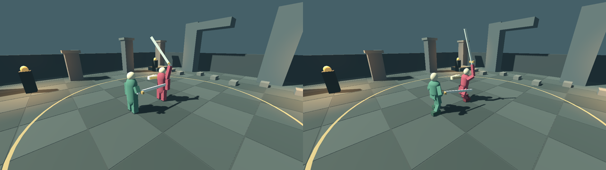
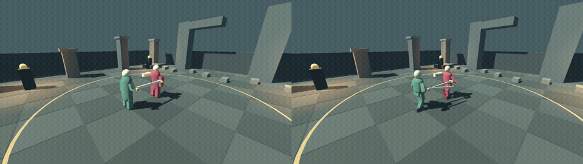
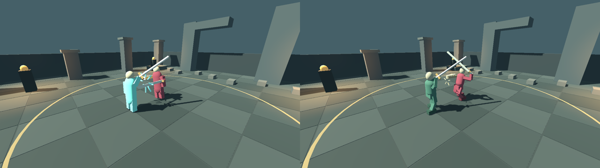
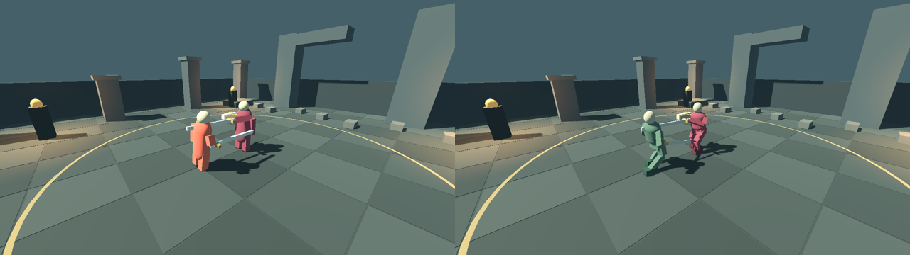
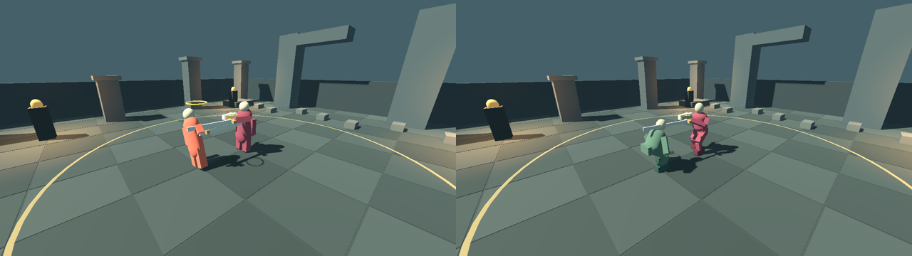
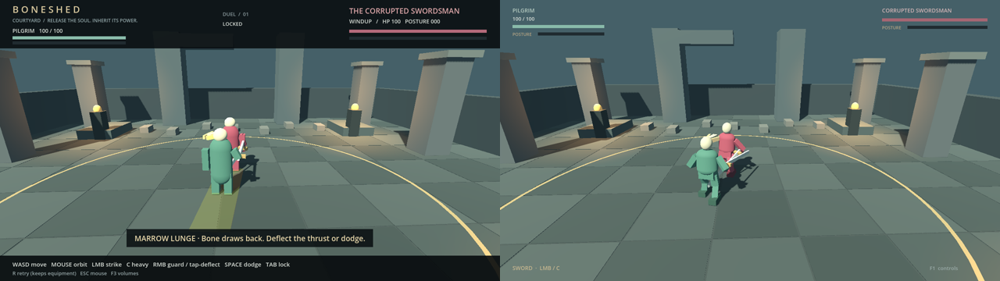

# Combat presentation 3 — rendered comparison and regressions

All side-by-side images and clips put **main before on the left, this slice after
on the right**. The baseline is `f722317a03d2dc9b0e0720573f0b44ef34161e95`.
The screenshots are actual Godot GL Compatibility renders on llvmpipe. They were
scaled/stacked for comparison, without synthesized frames or painted changes.
The source stills are retained in [before/](before) and [after/](after).

## Look first

[Light cut video](light-comparison.mp4) · [Heavy cut video](heavy-comparison.mp4) ·
[Marrow Lunge video](special-comparison.mp4)

The three pose videos use the same independent observation camera and the same
rules timeline, with HUD and debug boxes hidden. They show full preparation,
release, active motion and recovery at 30 fps, sampled from 60 Hz physics. These
are isolated curated-pose fixtures, not live AI footage or human playtesting.
The baseline worktree received only the capture script, not modified runtime code.

These stills follow actual `resolve_attack` results in the isolated fixture. The
new physical reactions replace reliance on the original cyan body flash and gold
posture-break halo. Note the outward weapon recoil versus collapsed broken body.

## Shipped scene with real input and AI

[Enemy lunge, normal input](enemy-input-comparison.mp4) ·
[Inherited lunge in duel two](player-input-comparison.mp4)

These clips come from `marrow_playthrough.gd` on each version. It sends mapped
keyboard/mouse events into the shipped salvage scene with AI active; it does not
write positions, health, phases, equipment or rewards. Its timing-aware input bot
proves reachability rather than beginner skill. These are short sequences from the
existing fixture: enemy preparation/contact and player preparation/contact/recovery.
Eight full-size final milestones are in [playthrough/](playthrough).

The final headless/rendered traces match exactly. Baseline/final combat fields also
match across all 856 samples: both actors' health, posture, phase, binding, remaining
time and event result. Both full playthroughs finish the second duel at tick 857.
Bone transforms intentionally differ. [Results and trace hashes](results.json).
The ordinary courtyard also retains its historical combat-runtime baseline fixture.

## Camera and controls

[Locked framing](locked.png) · [Rear wall](rear_wall.png) · [Side wall](side_wall.png)

The focused tests measure screen separation and inclusion of both fighters, rear
spring-arm collision, shoulder-anchor side-wall clearance, immediate mouse response,
a short manual-orbit override, reset, and actual F1/F3 input toggles. Camera stills
come from those live-physics checks. Remaining overlap and tight-corner limitations
are described in the [human playtest and follow-up plan](../../COMBAT_PRESENTATION_3.md).

## Executed validation

The [result record](results.json) and [logs/](logs) contain the executed outcomes,
including expected-failure controls. The engine is pinned to
`4.7.2.stable.official.ed1daf0bf`; [engine.json](engine.json) records version and
archive checksum verification against the installed official checksum file.

- Native shared combat/build boundary, all existing rule/strategy/negative controls,
  rendered input regressions, and headless/rendered sword timing.
- Shared Marrow Lunge, progression, four source mutation controls, broken bone mesh,
  real-input two-duel playthrough and exact headless/rendered trace parity.
- New pose/reaction/camera suite, headless and rendered. Deliberately lowering the
  heavy's weapon makes `heavy_prepares_above_head` fail. Hiding torso recoil/contact
  makes `deflection_has_visible_recoil_and_contact` and `hit_has_body_recoil` fail.
  The negative controls must exit 1 for those named failures.
- Build/salvage, anatomy and worldgen suites, with byte-identical regenerated examples.
- Web release/QA export and desktop browser keyboard/mouse regressions.

Commands and fresh-directory requirements are in the [implementation guide](../../COMBAT_PRESENTATION_3.md#reproduction).
Raw fresh runs remain under `/workspace/work/evidence/` in the execution workspace;
selected logs/check records and artifact hashes are committed here. Initial sandbox
socket restrictions were resolved with approved outside-sandbox test launches. An
approval-service usage-limit interruption was subsequently resolved on continuation.
The first two web attempts lacked templates in their isolated XDG data directory;
the final attempt uses links to the already installed, pinned templates.

No human has yet validated recognition without HUD explanations, physical input
latency, fun, or beginner difficulty. No October 18 human video was available.
llvmpipe frame times do not predict desktop GPU performance. Combat rules, attack
geometry, AI and enemy tuning stay intact; anatomical swept contact is a documented
next slice. No preview was published and this PR must not self-merge.
