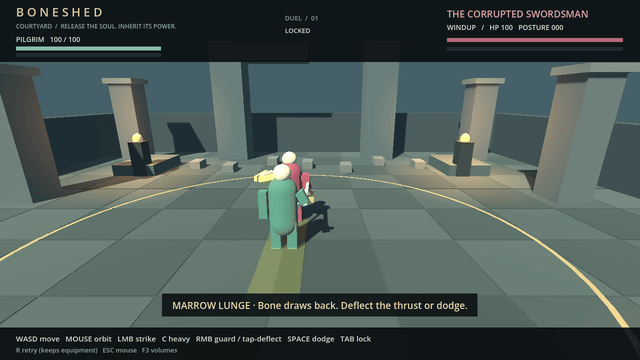
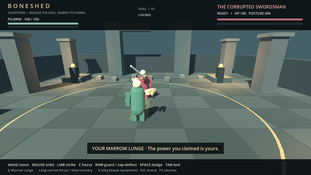

# First playable evidence — 2026-10-18

This record covers the shared Marrow Lunge and the complete courtyard progression
loop. [Human instructions, tuning and architecture](../../FIRST_PLAYABLE.md).
The result is ready for a human playtest; automated success does not establish fun,
human telegraph recognition, physical-device latency, or desktop GPU performance.

## Reproduction and baseline

The source baseline is merged PR #15, main
`ab525526a8c7971d5fac89a136e7a3ea7887b0d1`; its exact tree/commit were verified and
normal `git fetch origin main` subsequently completed. See
[source-baseline.json](source-baseline.json) and
[engine-verification.txt](engine-verification.txt). Tests use
`4.7.2.stable.official.ed1daf0bf`, GL Compatibility and llvmpipe, not the different
`godot` executable on the host's general PATH.

Commands use fresh directories:

```sh
BONESHED_GRAPHICAL_TIMEOUT=900 bash scripts/tooling/test.sh artifacts/native-fresh
bash scripts/tooling/test_builds.sh artifacts/builds-fresh
bash scripts/tooling/test_anatomy.sh artifacts/anatomy-fresh
bash scripts/tooling/test_worldgen.sh artifacts/worldgen-fresh
bash scripts/tooling/test_web.sh artifacts/web-fresh
BONESHED_GRAPHICAL_TIMEOUT=1200 bash scripts/tooling/test_marrow.sh artifacts/marrow-fresh
```

The baseline ran in `/workspace/Boneshed`; implementation ran in an isolated Git
worktree. Concurrent worktrees use separate `XDG_DATA_HOME` directories to prevent
collisions in existing tests' `user://` fixture filenames. Shell/editor/Xvfb/browser
sockets required execution outside the default socket-restricted sandbox. Earlier
attempts hit that restriction, the default 180 s rendering limit, and a shared fixture
filename collision; none required weakening test assertions. The successful runs use
fresh paths and the documented larger software-renderer allowance.

[Suite results](suite-results.json) records the successful baseline and final paths,
counts, exports and controls. Selected raw logs are retained under `baseline/` and
`after/`; the full uncurated fresh runs remain under `artifacts/` in the execution
workspaces. The ordinary courtyard's pre-integration runtime fixture, all 532 adapter
checks, all 63 adapter mutations, eight strategy regressions, old negative controls,
and sword pose timing checks remain enforced. The graphical runner explicitly selects
the ordinary scene. Obsolete assumptions that the lunge is unimplemented, the normal
entry scene never changes, and the arm reduces deflection are updated to the new task;
none of those checks is dropped.

## Actual-input progression run

`marrow_playthrough.gd` instantiates the **shipped scene** and submits keyboard/mouse
`InputEvent`s through the real input map. The AI stays enabled. The positive run never
sets fighter positions, health, combat phases, inventory, equipment or reward state.
The bot reads rules to choose well-timed inputs; it is much more informed than a new
human. Captures pause rendering without advancing physics, verified by exact trace parity.

| Requested milestone | Physics tick | Capture |
| --- | ---: | --- |
| Initial duel | 1 | [Initial courtyard](gameplay/01_initial_duel.png) |
| Enemy lunge telegraph | 58 | [Bone arm prepared](gameplay/02_enemy_lunge_telegraph.png) |
| Player defense | 88 | [Lunge deflected](gameplay/03_player_defends_lunge.png) |
| Legitimate enemy defeat | 467 | [Soul released / salvage prompt](gameplay/04_enemy_defeat.png) |
| Salvage acquisition | 468 | [Acquired, not yet equipped](gameplay/05_salvage_acquired.png) |
| Equipped augmentation | 469 | [Equipment inspection / next duel](gameplay/06_augmentation_equipped.png) |
| First inherited lunge | 545 | [Player uses the power](gameplay/07_first_inherited_lunge.png) |
| Second duel continues | 601 | [Combat continues normally](gameplay/08_second_duel_continues.png) |

The bot goes on to win the second duel at tick 857. Its first inherited attack is
blocked by the enemy: health/chip and 45 posture pressure apply through the shared
rules, and the enemy can counter. The rule fixtures also cover direct damage, dodge,
deflection, cancellation, win/loss, range, ownership and reset cases for both wielders.





These GIFs encode actual captured frames at 30 fps (two 60 Hz physics ticks per image),
scaled to 640×360 without synthesizing frames. The enemy sequence has 20 frames and
ends at the successful deflection, which interrupts the attack. The player's 42-frame
sequence shows preparation, release, active reach and most of recovery. Full-resolution
sequences are generated by the runner; the eight milestone PNGs above remain 1280×720.

## Timing, invariants and controls

- [Per-tick timing/input/mesh trace](timing-input-trace.csv): 856 post-physics samples,
  including both actors' health, posture, phase, binding, attack stage, remaining time,
  actual bone-mesh tip coordinates and held inputs. It preserves every sample rather
  than inferring timing from screenshots. A contact deflection immediately changes the
  attacker's phase to stagger; the trace therefore shows the interruption on that tick.
- [Trace parity](trace-parity.json): byte-identical headless/rendered JSON traces,
  with their SHA-256. This verifies the captured simulation on this binary/platform;
  it does not promise cross-platform physics determinism.
- [Playthrough summary](summary.json) and [rendered input checks](rendered-input.log).
- [193 rule/progression checks](rules-progression.log): same signature definition,
  non-default propagation of all eight signature values through both profiles,
  damage/posture/defense/range/cancels, source-of-victory gating, acquisition versus
  equip, atomic rollback, duplicate rejection, retry retention, second-duel loss/win,
  predictable AI selection and heavy-counter distance.
- [Four mutation controls](mutation-controls.json): removing lethal-contact authority,
  allowing duplicate claims, dropping lunge damage, and allowing repeat contacts each
  fail a named regression in an isolated project copy.
- [Broken bone-mesh control](negative-mesh-pose.log): shortening the actual mesh makes
  `inherited_active_pose_reaches_hit_tip` fail. This negative run is headless; the
  positive run uses rendering and the same mesh-transform measurement.

Sufficient automated evidence exists to try the loop using only ordinary controls.
Readability still needs a person: the player's body can occlude the close-range enemy
windup, and neither transforms nor GIFs establish whether its cue is easy to learn.
There is no audio, production character animation, disk save, arbitrary body graph,
new enemy content, server reward protection, published preview or self-merge here.
